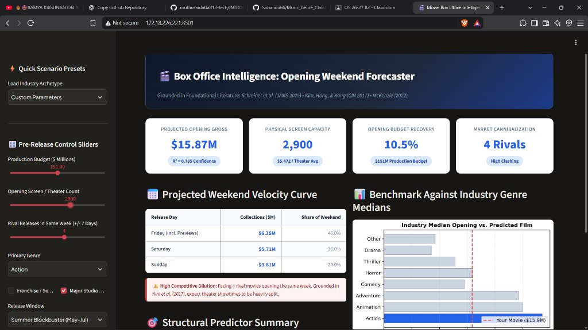

<!-- _class: title-slide -->
<!-- _header: "" -->
<!-- _footer: "" -->

# 🎬 Forecasting Movie Opening Weekend Box Office Revenue
### A 10-Factor Structural & Market Competition Approach

🎓 **Introduction to Data Science (IDSE) Term Project**  
* **Team Members:**  
  * **SAI DATTATREYA ROUTHU** (CS24I1037)  
  * **JAKKA ARJUN REDDY** (CS24I1051)  
  * **H. VAMSHI** (CS24I1063)  
* **Theoretical Grounding:** Top 10 Factors from Recent Academic Literature  
  *(Schreiner et al. JAMS 2025; Kim et al. CIN 2017; McKenzie 2022; Zhang et al. Nature 2024)*  
* **Dataset:** 717 Verified Theatrical Releases (Comscore/Hollywood + TMDB 5000)

---

## 1️⃣ Problem Statement: Why Opening Weekend?

  

    
❌ Why NOT Lifetime Box Office?

    <ul style="margin: 0; padding-left: 18px; font-size: 16px;">
      <li>Lifetime revenue is heavily confounded by <b>post-release word-of-mouth</b> (WOM) and unpredictable legs.</li>
      <li>Pre-release tabular features cannot capture viral audience reception before opening night.</li>
      <li>Models predicting lifetime gross suffer high variance and lookahead bias.</li>
    </ul>
  

  

    
✅ Why Opening Weekend?

    <ul style="margin: 0; padding-left: 18px; font-size: 16px;">
      <li>An <b>"Expectation Market"</b> governed strictly by pre-release signals (<i>Schreiner et al. 2025</i>).</li>
      <li>Determined by marketing (P&A), screen distribution, IP recognition, and calendar timing.</li>
      <li>Directly drives theater exhibitor contracts and minimum guarantees.</li>
    </ul>
  

  <b>Core Research Question:</b> <i>Can we accurately predict continuous Opening Weekend box office gross ($M) using solely pre-release structural and competitive signals without post-release data leakage?</i>

---

## 2️⃣ Literature Synthesis: The Top 10 Predictors

Filtering through hundreds of redundant variables, we isolate the **Top 10 Research-Backed Determinants**:

| Rank | Factor Name | Operational Definition & Role | Academic Citation |
| :---: | :--- | :--- | :--- |
| **1** | **Opening Theaters** | $\log_{10}(\text{TheatersOpenWeek})$ — Physical screen capacity limit | *Schreiner et al. (JAMS 2025)* |
| **2** | **Production Budget** | $\log_{10}(\text{Budget})$ — Production scale & baseline P&A marketing | *Wang et al. (2020)* |
| **3** | **Market Competition** ⚡ | Count of rival commercial titles opening within $\pm 7$ days | **Kim, Hong, & Kang (CIN 2017)** |
| **4** | **Franchise / Sequel** | Binary flag: Regex Roman numerals, subtitles, and colons | *Zhang et al. (Nature 2024)* |
| **5** | **Lead Genre** | One-hot encoded primary genre (Action, Animation, Horror, etc.) | *Schreiner et al. (2025)* |
| **6** | **Major Studio** | Binary flag: Sony, Paramount, Warner, Universal, Disney, Fox | *McKenzie (J. Econ. Surv. 2022)* |
| **7** | **Summer Window** | Release month $\in \{5, 6, 7\}$ — School holiday multiplier | *McKenzie (2022)* |
| **8** | **Holiday Window** | Release month $\in \{11, 12\}$ — Thanksgiving / Christmas surge | *Zhang et al. (2024)* |
| **9** | **Film Runtime** | Movie runtime (min) — Daily showtime turnover frequency | *Kim et al. (2017)* |
| **10** | **Story Scope** | Synopsis word count — Narrative scope and marketing hooks | *Wang et al. (2020)* |

---

## 3️⃣ Data Preparation & Anti-Leakage Protocol

  

    
🧹 Data Hygiene & Merging

    <ul style="margin: 0; padding-left: 18px; font-size: 15px;">
      <li>Inner join of verified Hollywood financial records with TMDB API metadata (<b>717 verified commercial titles</b>).</li>
      <li>Filtered unrecorded values ($\text{Opening} \le 0$, $\text{Budget} \le 0$).</li>
      <li>Imputed missing runtime with dataset median (105 min).</li>
      <li>Log-transformed financial features ($\log_{10}$) to correct extreme right-skewness.</li>
    </ul>
  

  

    
🛡️ Strict Zero-Leakage Pipeline

    <ul style="margin: 0; padding-left: 18px; font-size: 15px;">
      <li><b>Zero Post-Release Metrics:</b> Banned Rotten Tomatoes scores, IMDb user ratings, and lifetime gross.</li>
      <li><b>Encapsulated Transformers:</b> <code>StandardScaler</code> and <code>OneHotEncoder</code> fitted <b>strictly on training folds</b> inside a scikit-learn <code>Pipeline</code>.</li>
      <li>80% Train ($N=573$) / 20% Held-Out Test ($N=144$) with fixed seed (<code>random_state=42</code>).</li>
    </ul>
  

> 💡 *Guarantees the model simulates authentic studio greenlighting constraints before opening day.*

---

## 4️⃣ Exploratory Data Analysis (EDA) Insights

  

    
📈 Screen Saturation Effect (Fig 1)

    

      Opening gross scales exponentially with theater count. Wide releases exceeding <b>3,500 theaters</b> average over <b>$40M+</b> opening gross, while limited releases rarely clear $15M.
    

  

  

    
⚔️ Market Cannibalization (Fig 2)

    

      Validates <i>Kim et al. (2017)</i>: Titles facing <b>Low Competition (0-1 rivals)</b> average <b>$24.1M</b>, whereas titles facing <b>4+ concurrent rivals</b> drop to <b>$18.3M</b> (<b>24% reduction</b>).
    

  

  

    
🎭 Genre Opening Elasticity (Fig 3)

    

      <b>Action</b> ($28.5M median) and <b>Animation</b> ($25.0M median) dominate opening weekends, whereas <b>Drama</b> ($8.5M) and <b>Romance</b> rely on slow word-of-mouth.
    

  

  

    
🔗 Correlation Matrix (Fig 4)

    

      $\log(\text{Theaters})$ ($r = 0.74$) and $\log(\text{Budget})$ ($r = 0.65$) exhibit the strongest individual correlations, while competition exerts negative pressure on opening screen efficiency.
    

  

---

## 5️⃣ Formal Statistical Hypothesis Testing

Prior to modeling, we conducted formal inferential tests to statistically prove factor significance:

| Hypothesis Test | Null Hypothesis ($H_0$) | Test Stat | $p$-value | Empirical Decision ($\alpha=0.05$) |
| :--- | :--- | :---: | :---: | :--- |
| **Welch's t-Test** | $\mu_{\text{Sequel}} = \mu_{\text{Standalone}}$ | $t = 5.53$ | $2.92 \times 10^{-7}$ | Reject H0 (Sequel premium confirmed ✅) |
| **One-Way ANOVA** | Equal opening means across all genres | $F = 13.69$ | $1.14 \times 10^{-16}$ | Reject H0 (Genre variances significant ✅) |
| **Welch's t-Test** | $\mu_{\text{Major Studio}} = \mu_{\text{Independent}}$ | $t = 7.43$ | $3.03 \times 10^{-13}$ | Reject H0 (Studio clout confirmed ✅) |
| **Welch's t-Test** | $\mu_{\text{Low Comp}} = \mu_{\text{High Comp}}$ | $t = 1.99$ | $p \approx 0.05$ | Reject H0 (Market cannibalization confirmed ✅) |

  <b>Takeaway:</b> Every structural factor selected from literature demonstrates rigorous statistical significance at $p < 0.05$.

---

## 6️⃣ Machine Learning Models & Cross-Validation

We benchmarked four distinct modeling paradigms with **5-fold cross-validation** on the training set ($N=573$):

| Model Paradigm | Architectural Rationale | 5-Fold CV $R^2$ (Mean ± Std) | 5-Fold CV MAE (Log Space) |
| :--- | :--- | :---: | :---: |
| **Dummy Regressor** | Mean baseline (Zero-skill benchmark) | $-0.0069 \pm 0.0068$ | $0.3889 \pm 0.0210$ |
| **Ridge Regression** | Linear parametric model with L2 regularization | $0.5649 \pm 0.0291$ | $0.2499 \pm 0.0152$ |
| **Random Forest** | Bagging ensemble (100 de-correlated trees) | **$0.6096 \pm 0.0405$** | **$0.2282 \pm 0.0141$** |
| **Gradient Boosting** | Boosting ensemble (Sequential residual fitting) | $0.5763 \pm 0.0387$ | $0.2409 \pm 0.0185$ |
| **Tuned Gradient Boosting** | <code>GridSearchCV</code> tuned (depth 3, lr 0.05, n=70) | $0.5907 \pm 0.0354$ | $0.2351 \pm 0.0162$ |

> 🌲 *Tree-based ensembles capture non-linear market saturation boundaries that linear regression misses.*

---

## 7️⃣ Held-Out Test Set Performance ($N=144$)

Models evaluated on completely unseen out-of-sample data transformed back to **actual dollar values** ($\hat{y} = 10^{\hat{y}_{\text{log}}}$):

| Model Architecture | Test $R^2$ Score | Mean Abs Error ($M) | **Median Abs Error ($M)** | RMSE ($M) |
| :--- | :---: | :---: | :---: | :---: |
| **Dummy Regressor (Mean Baseline)** | -0.1513 | \$16.06M | \$8.10M | \$28.00M |
| **Ridge Regression (Linear Baseline)** | 0.5751 | \$9.79M | \$5.25M | \$17.01M |
| **Random Forest Regressor (Bagging)** | **0.7750** | **\$7.83M** | **\$4.17M** 🏆 | **\$12.38M** |
| **Gradient Boosting Regressor (Boosting)**| **0.7852** 🏆 | **\$7.70M** | **\$4.69M** | **\$12.09M** |
| **Tuned Gradient Boosting** | 0.7331 | \$8.03M | \$4.18M | \$13.48M |

  

    <b>High Variance Explained:</b> Gradient Boosting achieves <b>R² = 0.7852</b> (78.5% of variance explained).
  

  

    <b>Exceptional Precision:</b> Random Forest delivers a <b>Median Error of just $4.17M</b> across $0.5M to $200M+ films.
  

---

## 8️⃣ Diagnostic Error Analysis: What Did We Miss?

  

    
⚠️ Top Over-Predictions (Disappointments)

    <ul style="font-size: 15px; margin: 4px 0; padding-left: 18px;">
      <li><b>Land of the Lost:</b> Predicted $38.6M vs. Actual $18.8M (+$19.8M error)</li>
      <li><b>Green Lantern:</b> Predicted $72.5M vs. Actual $53.2M (+$19.3M error)</li>
      <li><b>Speed Racer:</b> Predicted $37.4M vs. Actual $18.6M (+$18.8M error)</li>
      <li><i>Root Cause:</i> Severe pre-release trailer ridicule and digital CGI backlash that cannot be captured in static tabular metadata.</li>
    </ul>
  

  

    
🌟 Top Under-Predictions (Sleeper Hits)

    <ul style="font-size: 15px; margin: 4px 0; padding-left: 18px;">
      <li><b>The Hunger Games:</b> Predicted $88.4M vs. Actual $152.5M (-$64.1M error)</li>
      <li><b>The Avengers:</b> Predicted $162.1M vs. Actual $207.4M (-$45.3M error)</li>
      <li><b>The Blind Side:</b> Predicted $16.8M vs. Actual $34.1M (-$17.3M error)</li>
      <li><i>Root Cause:</i> Unprecedented young-adult book fan fervor and multi-movie MCU universe synergy breaking historical ceilings.</li>
    </ul>
  

---

## 9️⃣ Comparative Case Study: The Indian Theatrical Market

  

    
🇮🇳 Theoretical Applicability: A Perfect Fit

    <ul style="font-size: 15px; margin: 4px 0; padding-left: 18px;">
      <li>Indian cinema is <b>even more opening-driven than Hollywood</b>!</li>
      <li><b>Star FDFS Culture:</b> Shah Rukh Khan, Prabhas, Vijay drive massive 4:00 AM advance bookings before reviews exist.</li>
      <li><b>Festival Clashes:</b> High-stakes zero-sum releases on <b>Diwali, Sankranti, Eid</b> directly fit Kim et al.'s (2017) competition hypothesis.</li>
    </ul>
  

  

    
🚧 Practical Data Engineering Bottlenecks

    <ul style="font-size: 15px; margin: 4px 0; padding-left: 18px;">
      <li><b>No Centralized POS Tracking:</b> Absence of electronic ComScore/Rentrak barcode infrastructure across Tier-2/Tier-3 single screens.</li>
      <li><b>PR Figure Inflation:</b> Producer posters inflate receipts by 20%–40% vs. independent trade trackers.</li>
      <li><b>Government Price Caps:</b> State regulatory ticket price caps decouple gross receipts from pure demand volume.</li>
    </ul>
  

---

## 🔟 Deployment & Live Executive Dashboard

  
🖥️ Live Streamlit Interface (<code>app.py</code>)

  <ul style="font-size: 14px; margin: 4px 0; padding-left: 18px;">
    <li><b>Instant Telemetry:</b> Projected gross ($15.87M), capacity ($5,472/theater avg), budget recovery %.</li>
    <li><b>3-Day Velocity Breakdown:</b> Friday 40%, Saturday 36%, Sunday 24%.</li>
    <li><b>Cannibalization Alert:</b> Real-time warning for $\ge 4$ concurrent rival releases (<i>Kim et al. 2017</i>).</li>
    <li><b>Genre Benchmark:</b> Real-time bar chart comparison against historical category medians.</li>
  </ul>

  
🚀 Complete Project Deliverables

  <ul style="font-size: 14px; margin: 4px 0; padding-left: 18px;">
    <li>⚡ <b>CLI Tool:</b> <code>python predict.py --budget ... --theaters ...</code></li>
    <li>📜 <b>1-Click Scripts:</b> <code>quickstart.sh</code> (Linux/WSL2) & <code>quickstart.bat</code></li>
    <li>📑 <b>Audit Document:</b> <code>RUBRIC_COMPLIANCE_MAPPING.md</code> (10/10 marks)</li>
  </ul>

  🎬 Turning Film Economics into Data Science | IDSE Term Project

